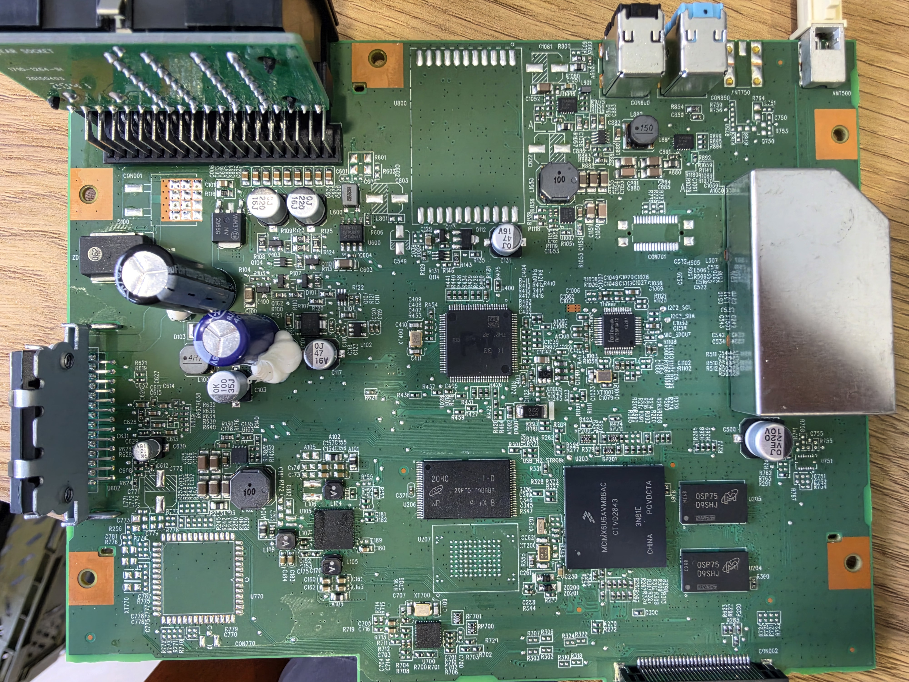
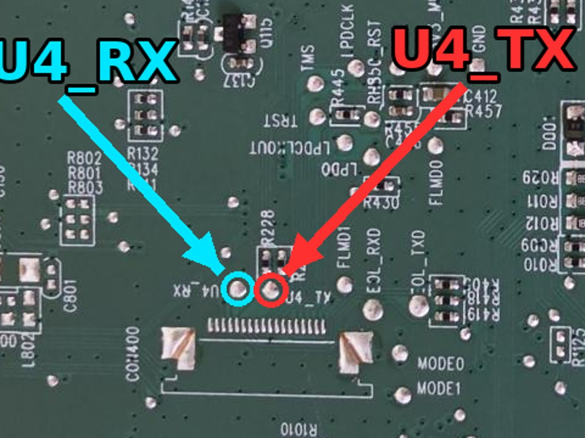
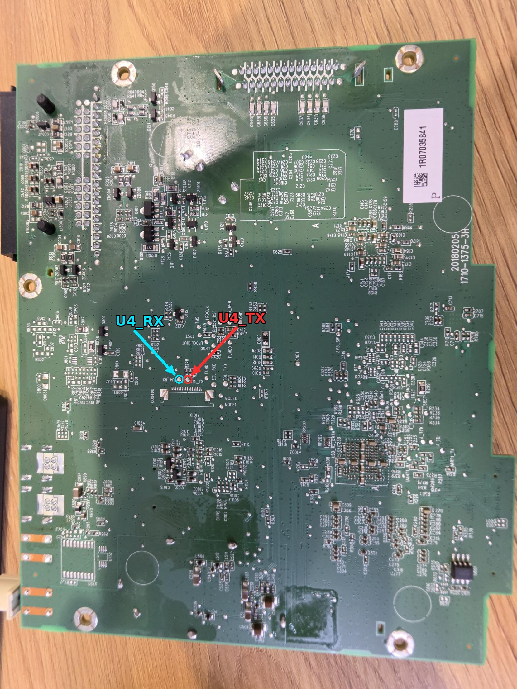

# Tiggo HU — a custom shell for the Chery Tiggo 4 (T19) head unit

A from-scratch replacement for the stock UI of the 2019 Chery Tiggo 4 (platform T19, Shinco i.MX6 DualLite head unit),
written in C on OpenGL ES 2 and running directly on the Vivante framebuffer — no Qt, no Weston.
The stock firmware stays on the unit and can still be booted.

Personal project for one car. Nothing here is affiliated with or endorsed by Chery, Shinco, Neusoft or Google.
Flashing anything to a head unit can brick it — use at your own risk.

## What it does

- **Home / dashboard**, apps grid, settings, display, vehicle info, light and dark themes, English / Ukrainian / Russian UI.
- **Media:** USB music and video (hardware VPU decoding), album art with a blurred art background, FM/AM radio.
- **Bluetooth** through the stock nFore stack: calls, phone book, A2DP music with AVRCP metadata.
- **Android Auto**, wired (USB AOA) and wireless (Bluetooth RFCOMM + 5 GHz Wi-Fi AP on an RTL8811AU dongle):
  video, audio, touch, media metadata and keys, and sensors (speed, night mode, driving status, steering angle, headlights).
- **Car data** from the body MCU over UART (`/dev/ttymxc2`): speed, climate, lights, steering, the rotary knob,
  steering-wheel keys, reverse camera with dynamic guide lines.
- **Lua apps** (`apps/`).
- Boot splash (`boot/huboot`), crash handler with a backtrace, a watchdog that restarts the shell on a crash.

## Hardware

Main board 1710-1375-3H (Shinco):

| Part | Chip |
|---|---|
| SoC | NXP i.MX6 DualLite `MCIMX6U6AVM08AC` |
| PMIC | NXP PF0200 (marking `SMPF0200`) |
| RAM | 2 × Micron DDR3 (`U204`, `U205`, FBGA code `D9SHJ`), 1 GB total |
| NAND | Micron `MT29F8G08ABABA` (`U206`), 8 Gbit = 1 GB SLC |
| Body MCU | Renesas RH850 (`U400`, marking removed): CAN, talks to the i.MX6 over UART |
| Radio / audio processor | NXP TEF6635, controlled by the MCU |
| Voice DSP | Fortemedia FM1388 |
| Bluetooth | CSR BlueCore (`U901`, marking `6311`), BCSP over UART5 `ttymxc4`; stock nFore stack on top |
| Camera video decoder | Analog Devices ADV7182 (`U700`, marking `ADV7182 BCPZ`), kernel driver `adv7180` |
| USB port power | TI TPS254900-Q1 (marking `254900Q`): USB charging port controller, short-to-battery protection |
| Audio power amplifier | chip under the heatsink bracket at the top edge; passive, no software control |
| Display | 1024x600 LVDS panel |

Empty footprints `U207` (BGA), `U770` (QFP64), `U800`.



## Layout

| Path | What |
|---|---|
| `src/` | The shell (C) |
| `tools/` | Scripts that run on the HU (start, watchdog, Wi-Fi AP, init), the NAND installer, asset and table generators |
| `boot/` | Boot splash: `boot_static.html` → PNG → `boot_img.h` → `huboot` |
| `wifi/` | RTL8811AU driver patch, hostapd / udhcpd configs, build notes |
| `apps/` | Lua apps |
| `res/`, `icons_png/` | Fonts, wallpapers, demo images, icon masks — inputs for `make assets` |
| `container/` | Podman images: ARM cross toolchain (Ubuntu 14.04, gcc 4.8, glibc 2.17 like the HU) and the PC build |
| `third_party/` | Lua 5.4, stb, libjpeg headers |

## Building

Everything builds in containers (Podman); the host is not touched.

```sh
sh container/build.sh                    # images localhost/tiggo-build and localhost/tiggo-pc
cp src/aa_cert.h.example src/aa_cert.h   # then fill in the Android Auto certificate and key, see below
sh tools/hu.sh assets                    # bake fonts and icons into assets/
sh tools/hu.sh pc                        # PC build: build/pc/hu;  sh tools/hu.sh run  opens it in a Wayland window
SYSROOT=/path/to/hu-rootfs sh tools/hu.sh arm   # HU build: build/arm/hu (stripped) + build/arm/hu.debug
```

The ARM build links against the head unit's own libraries (Vivante EGL/GLES, nFore `libbluelink`), so it needs
a sysroot: the root filesystem dumped from **your** head unit's NAND. Stock firmware is not included here.

**Android Auto certificate.** The phone only accepts a head-unit certificate signed by Google's Automotive Link CA.
`src/aa_cert.h` is git-ignored; `src/aa_cert.h.example` says where the well-known certificate and key come from.

**Wi-Fi driver and hostapd** for wireless Android Auto are built separately, see `wifi/README.md`.

## Getting started: root over the UART console

The kernel console and U-Boot are on **UART4** of the i.MX6 (`ttymxc3`), 115200 8N1.

1. Connect a **3.3 V** USB–UART (TTL) adapter to the UART4 test pads on the back of the main board
   (board 1710-1375-3H): `U4_RX` and `U4_TX`, next to connector `CON1400`. Adapter RX ← `U4_TX`,
   adapter TX → `U4_RX`, adapter GND ↔ board ground (e.g. the `GND` pad nearby).
   Do not connect the adapter's VCC, and do not use a 5 V adapter.

    

2. Open a terminal on the adapter (`picocom -b 115200 /dev/ttyUSB0`), switch the head unit on and keep pressing
   **Space** until the U-Boot prompt `=>` appears (there is no "Hit any key" message).
3. Boot into a root shell (only for this boot, nothing is saved to the U-Boot environment):
   ```
   setenv bootargs ${bootargs} init=/bin/sh; boot
   ```
4. In the shell, bring up what init would normally do; `deferred_initcalls` is required, otherwise USB host does not work:
   ```
   mount -t proc proc /proc; mount -t sysfs sys /sys
   cat /proc/deferred_initcalls
   ```
5. **Back up the whole NAND first** (USB stick mounted at `/mnt`):
   ```
   mount /dev/sda1 /mnt; cd /mnt
   for n in $(seq 0 11); do nanddump -q --bb=padbad -f mtd$n.bin /dev/mtd$n; done
   dd if=/dev/mtd12 of=mtd12.bin bs=4096; md5sum mtd*.bin > md5.txt; sync
   ```
   `cat /proc/mtd` lists the partitions. The root filesystem is `mtd11` (`rootfs`, UBI); on the PC
   `ubireader_extract_files -o rootfs mtd11.bin` unpacks it; `rootfs/<number>/rootfs` is the `SYSROOT` for the ARM build.
   The root is mounted read-only: `mount -o remount,rw /` before changing anything.
6. Set up SSH access (an `sshd` with your key, and `tools/rescue/` for a reverse tunnel over phone USB tethering),
   then use the installer below.

The MCU reboots the head unit if it gets no keep-alive for ~15 s, but only after the first keep-alive, so an
`init=/bin/sh` boot without the shell running stays up indefinitely.

## Installing on the head unit

Needs root SSH access to the head unit (the HU reaches the PC through a phone's USB tethering and a reverse SSH tunnel,
`tools/rescue/`).

```sh
sh tools/nand-install.sh stage   # copy the build to the HU's RAM and verify sha256
sh tools/nand-install.sh nand    # install into NAND (stock shell kept; see the script header for rollback)
```

The stock UI boots instead of this shell when a USB stick with an empty file named `STOCK` in its root is inserted.

## License

MIT — see [LICENSE](LICENSE). Third-party code under `third_party/` keeps its own licenses (Lua — MIT,
stb — public domain / MIT, libjpeg headers — IJG).
